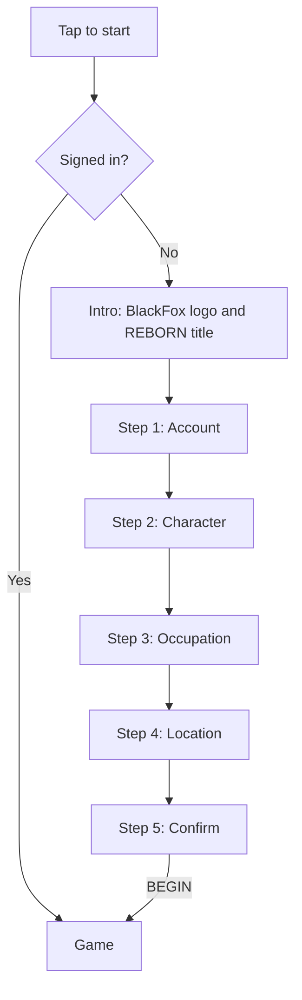

<div align="center">

# REBORN

**An open world 3D adventure for the web. Start a new life.**


A [BlackFox](#about-blackfox) project.


</div>

---

## Table of Contents

- [About](#about)
- [Features](#features)
- [Screenshots](#screenshots)
- [Player Flow](#player-flow)
- [Tech Stack](#tech-stack)
- [Project Structure](#project-structure)
- [Getting Started](#getting-started)
- [How It Works](#how-it-works)
- [Roadmap](#roadmap)
- [Building the Mobile App](#building-the-mobile-app)
- [Security Notes](#security-notes)
- [About BlackFox](#about-blackfox)
- [License](#license)

---

## About

**Reborn** is an open world exploration game built for the browser, with a mobile app version planned. Players create an account, choose who they will be in their new life (character, occupation and starting location), and step into a world built for exploration.

The project is built with **plain JavaScript, HTML and CSS** and no framework, so the code stays small, readable and easy to modify.

> **Status:** the intro and the onboarding flow are complete. The 3D world, backend and mobile app are in progress.

---

## Features

**Available now**

- Cinematic intro: the BlackFox logo draws itself line by line (pure SVG and CSS, no video file), followed by the REBORN title
- Tap-to-start screen that also requests fullscreen and landscape on supported devices
- Skip button for returning players
- "Rotate your phone" prompt in portrait orientation
- 5-step onboarding with sliding transitions and progress dots
- Swipeable card pickers with arrow controls for character, occupation and location
- Sign up and log in switching on one screen
- Lightweight single-page screen system (`showScreen()`)
- Responsive layout tuned for phones in landscape and for desktop

**In progress**

- 3D open world (three.js)
- Real authentication and player profiles (Supabase)
- Android app (Capacitor)

---

## Screenshots

| Intro | Title |
|---|---|
|  |  |

| Account | Select Character |
|---|---|
|  |  |

| Confirm |
|---|
|  |

---

## Player Flow



Returning players skip the intro and go straight into the game. The account is created only at the final step, so no half-finished accounts are left behind.

---

## Tech Stack

| Area | Technology |
|---|---|
| Frontend | HTML5, CSS3, vanilla JavaScript (ES6) |
| Animation | SVG stroke animation and CSS transitions |
| 3D (planned) | [three.js](https://threejs.org/) with hand-modeled `.glb` assets |
| Backend (planned) | [Supabase](https://supabase.com/) (auth and database) |
| Mobile (planned) | [Capacitor](https://capacitorjs.com/) for Android |
| Hosting | GitHub Pages |

---

## Project Structure

```
reborn/
├── index.html          # All screens (start, logo, title, auth, game)
├── css/
│   └── style.css       # All styling, one property per line
├── js/
│   └── main.js         # All logic, split into commented sections
├── docs/
│   └── screenshots/    # Images used in this README
└── README.md
```

`js/main.js` is organized into five sections:

| Section | Responsibility |
|---|---|
| 1. SCREENS | `showScreen()` shows one screen and hides the rest |
| 2. AUTH | 5-step sign up, log in, and the signed-in check |
| 3. GAME | `preloadGame()` and `startGame()` for the 3D world |
| 4. INTRO | Timeline for the logo and title sequence |
| 5. START | The first tap, which decides what the player sees |

---

## Getting Started

### Run locally

No build step or dependencies are needed.

**Option 1: open the file**

Open `index.html` in a browser.

**Option 2: use a local server (recommended)**

```bash
# from the project folder
npx serve .
```

Or copy the folder into `htdocs` and start Apache if you use XAMPP, then visit `http://localhost/reborn/`.

### Test on a phone

Open the local server address on a phone connected to the same Wi-Fi. Landscape lock and fullscreen only work on supported mobile browsers and in the installed app.

### Deploy to GitHub Pages

1. Push the project to a GitHub repository
2. Go to **Settings > Pages**
3. Select the branch and the root folder, then save
4. Your site will be live at `https://<your-username>.github.io/<repo-name>/`

All asset paths are relative (`css/style.css`), so the project works under a repository subpath.

---

## How It Works

### Screen system

Every screen is a `<div class="screen" id="...">`. Only one has the class `show` at a time, and CSS fades between them.

```js
showScreen("auth");   // shows the auth screen, hides the others
showScreen(null);     // hides everything (used between intro parts)
```

To add a new screen, add a `<div class="screen" id="newscreen">` to `index.html` and call `showScreen("newscreen")`.

### Intro animation

The fox is drawn with SVG polygons. Each shape starts with `stroke-dashoffset` fully hidden and animates to zero (the draw-on effect), then the fill fades in. The whole logo is a few kilobytes and loads instantly on slow networks.

### Onboarding steps

The five steps sit side by side in a horizontal track. Moving to the next step slides the track with `translateX`. Each card step is created by one reusable function:

```js
setupPicker("characterPicker", "character", "characterNext");
```

### Editing content

| To change | Edit |
|---|---|
| Card names | the `.card-name` text in `index.html` |
| Card images | replace `.card-img` with an `` in `index.html` |
| Add or remove a card | copy or delete a `.card` block, no JS change needed |
| Intro timing | the `setTimeout` values in section 4 of `main.js` |
| Colors | the CSS variables at the top of `style.css` |

---

## Roadmap

- [x] Intro sequence (BlackFox logo and REBORN title)
- [x] Tap-to-start, skip, and rotate prompts
- [x] Single-page screen system
- [x] 5-step onboarding with card pickers
- [x] Responsive layout for landscape phones
- [ ] Supabase authentication (sign up, log in, session check)
- [ ] Player profiles saved to the database
- [ ] Real character, occupation and location artwork
- [ ] 3D world with hand-modeled terrain
- [ ] Player movement and camera
- [ ] Android app with Capacitor
- [ ] Sound and music
- [ ] Multiplayer (to be decided)

---

## Building the Mobile App

The project is designed to be wrapped with Capacitor.

```bash
npm init -y
npm install @capacitor/core @capacitor/cli @capacitor/android
npx cap init Reborn com.blackfox.reborn --web-dir .
npx cap add android
npx cap sync
npx cap open android      # opens Android Studio to build the APK
```

Notes:

- Set the app orientation to landscape in `AndroidManifest.xml` (`android:screenOrientation="sensorLandscape"`)
- Update the app id (`com.blackfox.reborn`) to your own before publishing
- Run `npx cap sync` after every change to the web files

---

## Security Notes

- The Supabase **anon** key is designed to be public, but only if **Row Level Security** is enabled on every table
- Never put the Supabase **service_role** key in frontend code
- The current "signed in" check is a **temporary local flag** for testing. It must be replaced with a real session check (`supabase.auth.getSession()`) before launch, since anything stored in the browser can be edited by the player
- Never store or log plain passwords

---

## About BlackFox

BlackFox is the studio behind Reborn and other games and apps.

---

## License

Copyright (c) BlackFox. All rights reserved.

This source is published for viewing. You may not copy, modify, or distribute it without permission. To use a different license (for example MIT), replace this section and add a `LICENSE` file.
